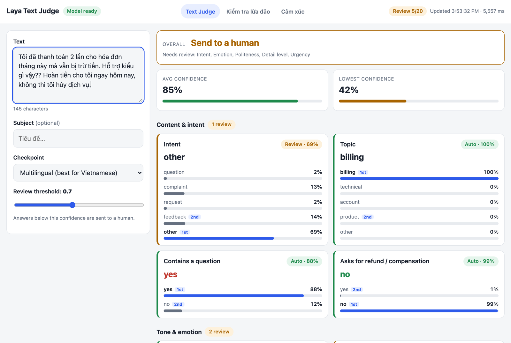
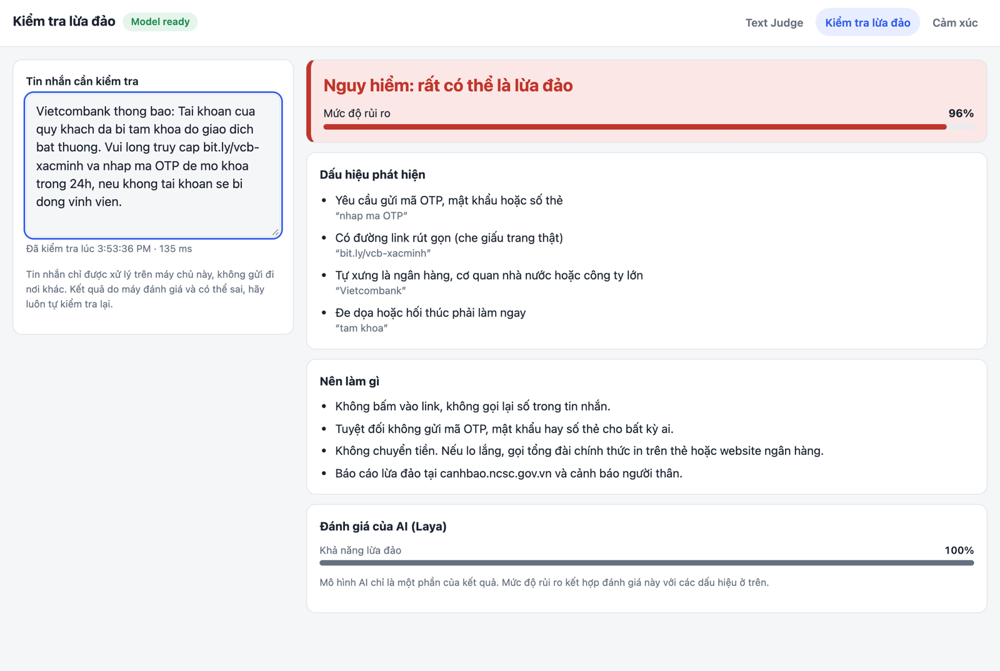
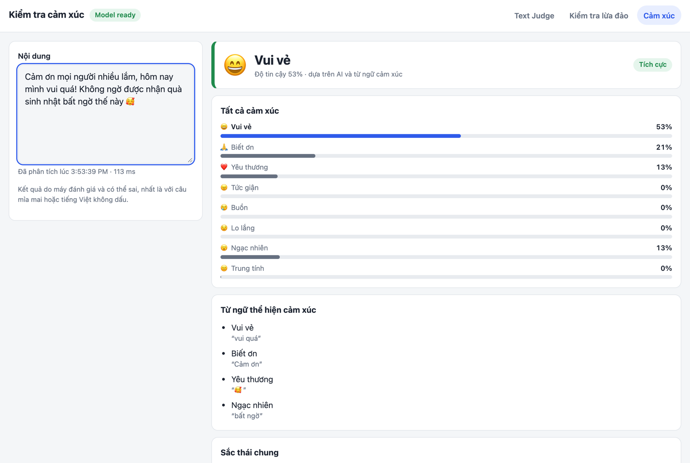

<div align="center">

# ⚖️ Laya Text Judge

**Paste a message. Get instant judgements, scam warnings and emotions. Runs on your laptop, no API key.**

[](https://www.python.org/)
[](https://www.djangoproject.com/)
[](https://huggingface.co/convaiinnovations/laya)
[](#)



</div>

## ✨ Features

- 🧠 **Text Judge**: 20 questions (intent, sentiment, toxicity, spam, urgency…) answered live as you type
- 🛡️ **Scam checker**: spots Vietnamese SMS, Zalo and email scams and explains why
- 💬 **Emotion checker**: 8 emotions, plus the words that show them
- 🔒 **100% local**: nothing you paste leaves your machine

## 🚀 Quick start

```bash
git clone https://github.com/ducdinh-codehub/laya-demo.git
cd laya-demo
python3 -m venv .venv
.venv/bin/pip install -r requirements.txt
.venv/bin/python manage.py runserver
```

Open http://127.0.0.1:8000. The first run downloads the model (~2.8 GB).

## 📸 Screenshots

| Scam checker | Emotion checker |
|---|---|
|  |  |

## ⚠️ Good to know

- Results can be confidently wrong. Test on your own messages before relying on them.
- Change the questions in `judge/questions.json`, no code needed.
- Built for local use. Harden it before putting it online.

## 🙏 Credits

Built on [Laya](https://huggingface.co/convaiinnovations/laya) by Convai Innovations (Apache 2.0).
