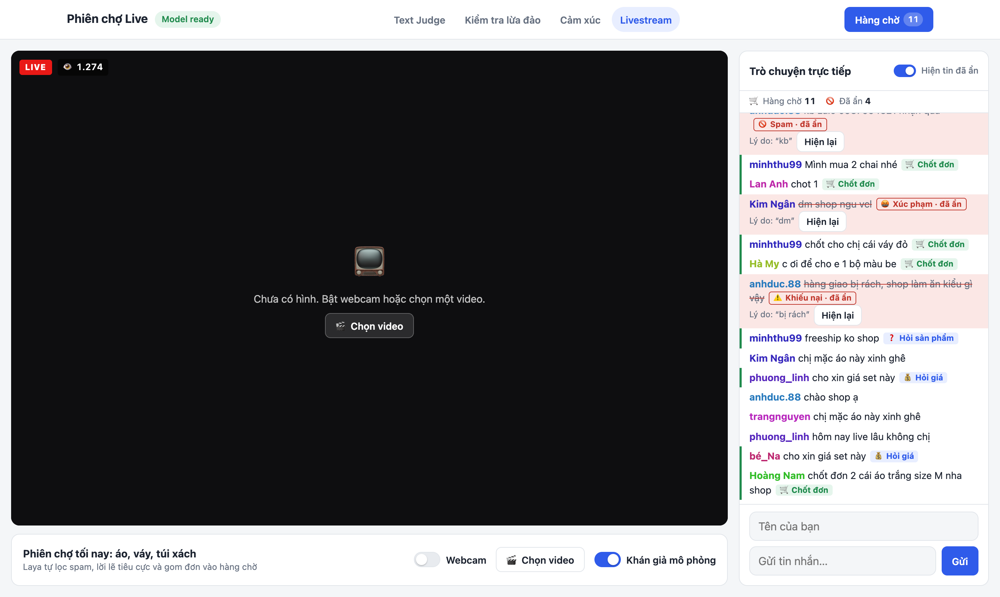
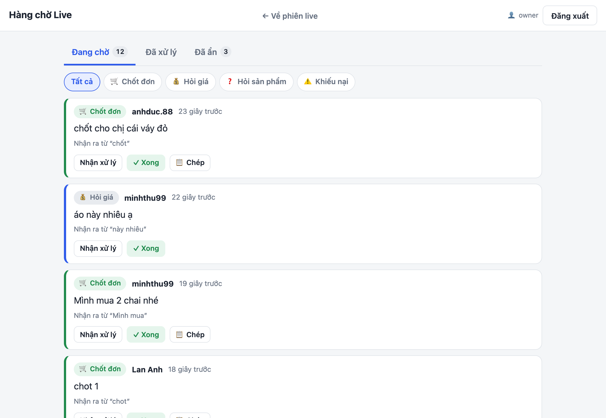

<div align="center">

# ⚖️ Laya Text Judge

**Paste a message. Get instant judgements, scam warnings and emotions, or moderate a live-selling chat. Runs on your laptop, no API key.**

[](https://www.python.org/)
[](https://www.djangoproject.com/)
[](https://huggingface.co/convaiinnovations/laya)
[](#)
[](LICENSE)


</div>

## ✨ Features

- 🧠 **Text Judge**: 20 questions (intent, sentiment, toxicity, spam, urgency…) answered live as you type
- 🛡️ **Scam checker**: spots Vietnamese SMS, Zalo and email scams and explains why
- 💬 **Emotion checker**: 8 emotions, plus the words that show them
- 📝 **Worksheet solver**: reads a photo of a multiple-choice test and shows which answer Laya picks, scored against your answer key
- 📺 **Livestream chat**: hides spam and insults, and sends orders and price questions to a queue your helpers can work through
- 🔒 **100% local**: nothing you paste leaves your machine

## 🚀 Quick start

```bash
git clone https://github.com/ducdinh-codehub/vietnamese-text-judge.git
cd vietnamese-text-judge
python3 -m venv .venv
.venv/bin/pip install -r requirements.txt
.venv/bin/python manage.py migrate
.venv/bin/python manage.py createsuperuser   # your shop-owner login
.venv/bin/python manage.py runserver
```

Open http://127.0.0.1:8000. The first run downloads the model (~2.8 GB).

## 📺 Livestream chat

Open http://127.0.0.1:8000/live. Switch between your webcam and a video, and turn on the simulated audience to see the moderator at work.



Orders, price and product questions and complaints go to the queue at `/live/queue`. To let a helper work it, create their account in `/admin` and give them the permission *Can work through the livestream queue*. Measure the filter with `.venv/bin/python live_eval.py`.

**↺ Làm lại từ đầu** clears the chat and queue so you can demo again.

Demo mode is on by default: every visitor gets the moderator features without logging in (the queue, hidden comments and why they were hidden, and the reset button), and queue actions are recorded under a shared `demo` user. Start with `LAYA_LIVE_DEMO=0` before putting the site online so only logged-in moderators can.

## 📝 Worksheet solver

Open http://127.0.0.1:8000/worksheet, choose a photo of a multiple-choice test (or paste its text) and add the answer key, like `1B 2A 3D`, to see how many Laya gets right. Questions should start with `Câu 1.`, `1.` or `Question 1.`, and options with `A.`, `B.`…

Laya judges text; it was not trained to know facts or do sums. On the 35 questions in `worksheet_eval.py` it scores 17% (14% quantized), below the 25% of guessing at random, so treat this page as a test of the model, not a way to solve homework. Measure it with `.venv/bin/python worksheet_eval.py`, prefixed with `LAYA_ONNX=onnx/laya-multilingual-int8.onnx` for the quantized model.

To make Laya better at school tests, fine-tune it on Vietnamese exam questions (everything is in `finetune/`, see `finetune/README.md` to get the data), then pick **Laya fine-tune trên đề thi Việt Nam** on the page:

```bash
python3 finetune/build_dataset.py
.venv/bin/python finetune/train.py               # ~45 min on an M3 Pro, writes checkpoints/laya-vi-school
.venv/bin/python worksheet_eval.py vi-school     # 34% on the 35 questions above, vs 17% before
```

On 2,126 held-out exam questions it goes from 29% to 45%. The data is non-commercial, so the fine-tuned checkpoint is for research only, and the other pages keep using the original model.

Reading the photo uses PaddleOCR (PP-OCRv5, Latin) on ONNX Runtime, about 1 s per page. It downloads ~15 MB of models on first use and loses stacked Vietnamese accents (ệ, ộ).

## 📸 Screenshots

| Scam checker | Emotion checker | Live order queue |
|---|---|---|
|  |  |  |

## ⚠️ Good to know

- Results can be confidently wrong. Test on your own messages before relying on them.
- Change the questions in `judge/questions.json`, no code needed.
- Built for local use. Harden it before putting it online.

## 🙏 Credits

Built on [Laya](https://huggingface.co/convaiinnovations/laya) by Convai Innovations (Apache 2.0).

## 📄 License

[MIT](LICENSE). The Laya model has its own Apache 2.0 license.
